# Lab 01: Rutas estáticas y ruta predeterminada


-yellow)

Laboratorio de enrutamiento con dos routers (**Rock1** y **Rock2**) donde se configuran rutas estáticas y una ruta predeterminada en IPv4/IPv6, y luego se **contrasta lo aprendido con tráfico real capturado en Wireshark** (TTL, MAC por salto, campos `Protocol`/`Next Header`, ICMP tipo 11, ARP vs Neighbor Discovery).

## Índice

1. [Objetivo](#1-objetivo)
2. [Topología y direccionamiento](#2-topología-y-direccionamiento)
3. [Comunicación local y remota](#3-comunicación-local-y-remota)
4. [Configuración y cambio de ruta en Rock1](#4-configuración-y-cambio-de-ruta-en-rock1)
5. [Verificación con ARP](#5-verificación-con-arp)
6. [Experimento: PC1 sin gateway](#6-experimento-qué-pasa-si-pc1-no-tiene-gateway)
7. [Análisis en Wireshark (red real, censurado)](#7-análisis-en-wireshark-red-real-sanitizado)
8. [Comparación IPv4 vs IPv6](#8-comparación-ipv4-vs-ipv6)
9. [Qué cambia en cada salto](#9-qué-cambia-en-cada-salto-conclusiones)
10. [Relación con seguridad](#10-relación-con-seguridad)
11. [Evidencias y privacidad](#11-evidencias-y-privacidad)
12. [Estructura del repositorio](#12-estructura-del-repositorio)
13. [Pendientes](#13-pendientes)

---

* **Herramientas:** Cisco Packet Tracer + Wireshark (sobre red real)
* **Nivel:** CCNA (enrutamiento básico)
* **Estado:** Completo (Packet Tracer + análisis en Wireshark). Pendiente: archivo `.pkt`

## 1. Objetivo

* Verificar la comunicación local (misma LAN) y remota (entre LAN A y LAN B).
* Reemplazar una ruta estática por una ruta predeterminada y comprobar que la conectividad se mantiene.
* Observar cómo cambian IP, MAC y TTL/Hop Limit en cada salto en entornos IPv4 e IPv6.
* Entender qué rol cumple el gateway predeterminado de un host y qué pasa cuando falta.
* Identificar en capturas reales los campos que identifican el protocolo de capa 4 (`Protocol` en IPv4, `Next Header` en IPv6).
* Comparar los encabezados IPv4 e IPv6 y el mecanismo de resolución de MAC (ARP vs Neighbor Discovery).

## 2. Topología y direccionamiento

Los routers se configuran con los hostnames **Rock1** y **Rock2**, conectados entre sí mediante un cable cruzado.

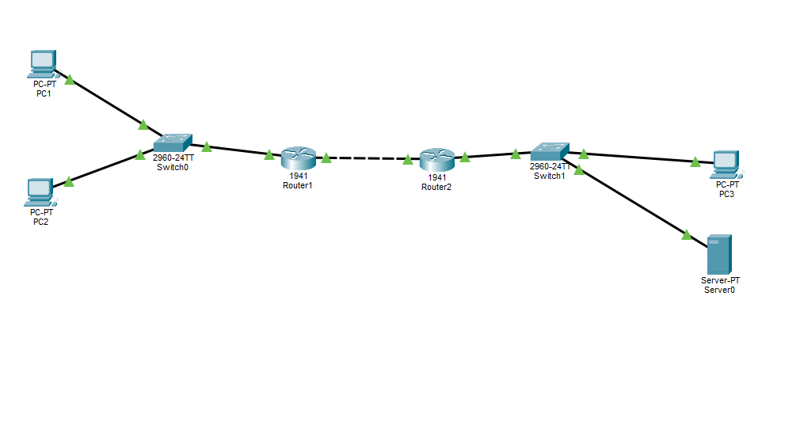

### Tabla de Direccionamiento IPv4

|Dispositivo|Interfaz|Dirección IP / Prefijo|Gateway Predeterminado|
|-|-|-|-|
|PC1|Fa0|192.168.1.10/24|192.168.1.1|
|PC2|Fa0|192.168.1.20/24|N/A|
|Rock1|Gi0/0|192.168.1.1/24|N/A (LAN A Gateway)|
|Rock1|Gi0/1|10.0.0.1/30|Enlace con Rock2|
|Rock2|Gi0/0|10.0.0.2/30|Enlace con Rock1|
|Rock2|Gi0/1|192.168.2.1/24|N/A (LAN B Gateway)|
|PC3|Fa0|192.168.2.10/24|192.168.2.1|
|Server0|Fa0|192.168.2.20/24|192.168.2.1|

### Tabla de Direccionamiento IPv6

|Dispositivo|Interfaz|Dirección IPv6 / Prefijo|Gateway Predeterminado|
|-|-|-|-|
|PC1|Fa0|2001:DB8:A::10/64|2001:DB8:A::1|
|Rock1|Gi0/0|2001:DB8:A::1/64|N/A|
|Rock1|Gi0/1|2001:DB8:FF::1/64|Enlace con Rock2|
|Rock2|Gi0/0|2001:DB8:FF::2/64|Enlace con Rock1|
|Rock2|Gi0/1|2001:DB8:B::1/64|N/A|
|PC3|Fa0|2001:DB8:B::10/64|2001:DB8:B::1|

### Verificación de interfaces (Rock2)

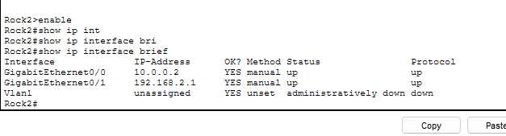

## 3. Comunicación Local y Remota

* **Comunicación Local (PC1 → PC2):** El paquete no cruza ningún router. El valor de **TTL es 128** e IP/MAC origen y destino se mantienen dentro de la misma LAN A.
* **Comunicación Remota (PC1 → PC3):** Al atravesar los routers Rock1 y Rock2, el paquete experimenta dos saltos, por lo que llega a destino con un **TTL de 126** (128 - 2).

Ping local (PC1 → PC2), TTL 128:

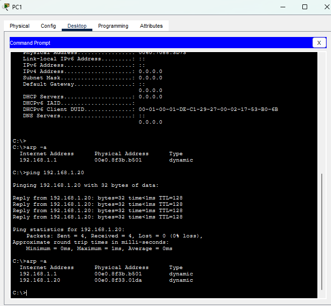

Ping remoto (PC1 → PC3), TTL 126:

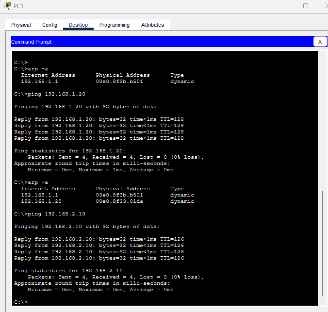

## 4. Configuración y Cambio de Ruta en Rock1

Se retiró la ruta estática específica hacia la LAN B y se implementó una ruta estática predeterminada (`0.0.0.0/0`) apuntando al siguiente salto. También se habilitó el procesamiento global de IPv6:

```
! Cambio de ruta en Rock1:
no ip route 192.168.2.0 255.255.255.0 10.0.0.2
ip route 0.0.0.0 0.0.0.0 10.0.0.2
!
! Configuración completa relevante:
interface GigabitEthernet0/0
 ip address 192.168.1.1 255.255.255.0
 ipv6 address 2001:DB8:A::1/64
!
interface GigabitEthernet0/1
 ip address 10.0.0.1 255.255.255.252
 ipv6 address 2001:DB8:FF::1/64
!
ipv6 unicast-routing
ip route 0.0.0.0 0.0.0.0 10.0.0.2
ipv6 route 2001:DB8:B::/64 2001:DB8:FF::2
```

Configuraciones completas y sanitizadas (sin contraseñas): [`configs/Rock1.txt`](configs/Rock1.txt) y [`configs/Rock2.txt`](configs/Rock2.txt).

> Nota: en IPv6 se mantiene una ruta **específica** hacia `2001:DB8:B::/64`; el cambio a ruta predeterminada se hizo solo en IPv4.

### Tabla de enrutamiento resultante (`show ip route`)

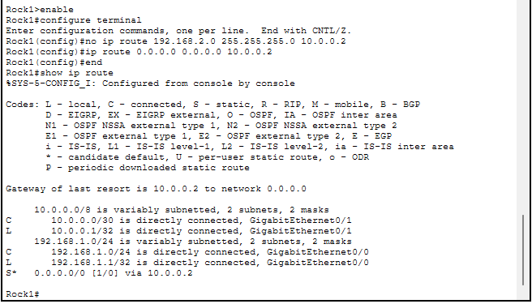

Salida en texto:

```
Gateway of last resort is 10.0.0.2 to network 0.0.0.0

     10.0.0.0/8 is variably subnetted, 2 subnets, 2 masks
C       10.0.0.0/30 is directly connected, GigabitEthernet0/1
L       10.0.0.1/32 is directly connected, GigabitEthernet0/1
     192.168.1.0/24 is variably subnetted, 2 subnets, 2 masks
C       192.168.1.0/24 is directly connected, GigabitEthernet0/0
L       192.168.1.1/32 is directly connected, GigabitEthernet0/0
S*   0.0.0.0/0 [1/0] via 10.0.0.2
```

|Código|Tipo|Cómo aparece|Para qué sirve|
|-|-|-|-|
|**C**|Conectada|Sola, al asignar IP a una interfaz y dejarla activa (`no shutdown`)|Red a la que el router está directamente conectado|
|**L**|Local|Acompaña a cada **C**|Es la IP de la propia interfaz (/32)|
|**S**|Estática|Se carga a mano: `ip route red máscara siguiente-salto`|Llegar a una red remota específica|
|**S**\*|Estática predeterminada|`ip route 0.0.0.0 0.0.0.0 siguiente-salto`|Ruta de **último recurso** (*Gateway of last resort*)|

El router siempre elige la ruta **más específica** que coincide con el destino. La predeterminada (`/0`) coincide con todo, pero es la menos específica, así que solo se usa cuando no hay otra mejor.

## 5. Verificación con ARP

Tabla ARP de PC1 antes y después de los pings:

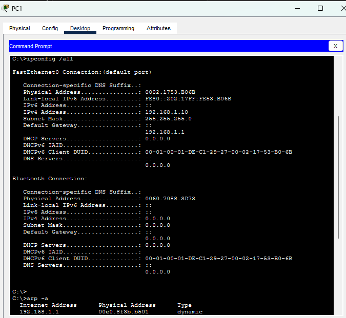

La captura del ping a PC2 (sección 3) muestra la tabla ARP ya con la MAC de PC2.

* Antes de hacer ping a PC2, `arp -a` solo mostraba el gateway (192.168.1.1) con la MAC de la interfaz Gi0/0 de Rock1.
* Después del ping a PC2 (192.168.1.20) apareció también su MAC.
* Al hacer ping a PC3 (192.168.2.10, otra subred) **no aparece la MAC de PC3**: PC1 resuelve por ARP la MAC del **gateway**, y el router se encarga del resto.

Esto confirma que, para destinos remotos, la IP destino es la de PC3 pero la MAC destino de la trama es la del gateway.

## 6. Experimento: ¿qué pasa si PC1 no tiene gateway?

Se quitó el gateway de PC1 y se probó:

|Destino|Subred|Resultado|
|-|-|-|
|PC2 (192.168.1.20)|Misma que PC1|**Funciona**, 4/4 respuestas, TTL=128|
|PC3 (192.168.2.10)|Otra subred|**Falla**, `Request timed out`, 100% perdidos|

Gateway de PC1 borrado (pestaña *Config*, campo *Default Gateway* IPv4 vacío):

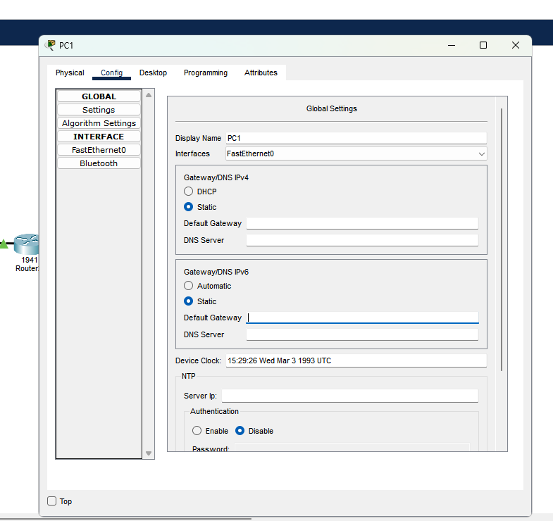

Pings desde PC1 sin gateway: a PC2 responde (TTL=128) y a PC3 expira (100% perdidos):

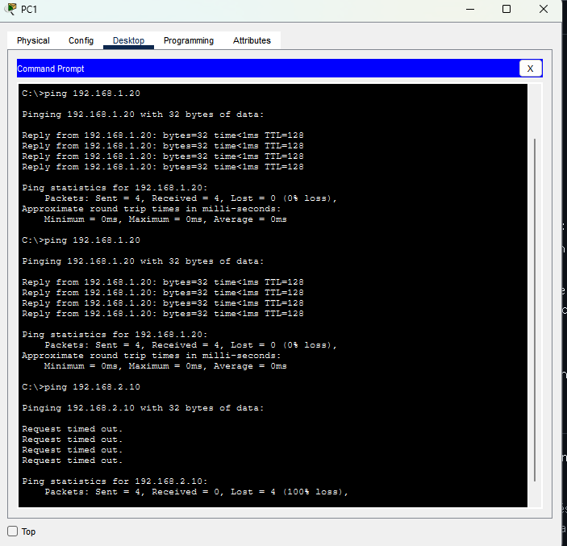

Interpretación:

* PC2 está en la misma subred, así que PC1 lo alcanza por capa 2 sin necesitar router (TTL=128: no hubo saltos).
* PC3 está fuera de la subred y PC1 no tiene a quién entregarle el paquete. En modo Simulación el paquete aparece como **Failed** en el propio PC1 y se observa tráfico de broadcast (probablemente ARP) en la LAN que nadie contesta.
* El mensaje fue `Request timed out` y no `Destination host unreachable`, que era lo que se esperaba en la hipótesis inicial. Es un buen recordatorio de que **el mensaje exacto depende de la implementación** y conviene verificarlo en vez de asumirlo.

Se restauró el gateway `192.168.1.1` y el ping a PC3 volvió a responder con TTL=126.

**Conclusión:** el gateway solo importa para **salir de la subred**. Sin él, la comunicación local sigue funcionando y la remota se cae.

## 7. Análisis en Wireshark (red real, sanitizado)

Además del laboratorio en Packet Tracer, se capturó tráfico de una PC con Windows en una red doméstica para observar los mismos campos en una red real.

> **Nota de privacidad:** el texto de este documento no incluye direcciones IP reales de la red doméstica, direcciones públicas del proveedor, direcciones IPv6 globales, MACs ni nombres de equipos. Las direcciones de la LAN real se indican con marcadores: `<IP-PC>` (la PC) e `<IP-gateway>` (el router doméstico).
>
> Las capturas de pantalla publicadas están **censuradas con rectángulos negros sólidos** (no con desenfoque, que puede revertirse): columnas *Source* y *Destination*, MACs y fabricantes, IPs del panel de detalles, identificador de la interfaz de red y panel hexadecimal. No se publica ningún archivo `.pcap`.

Filtros usados: `icmp`, `icmp.type == 8`, `icmp.type == 11`, `ip.proto == 6`, `ip.proto == 17`, `udp`, `ipv6.nxt == 6`, `icmpv6`.

### 7.1 Ejercicio A: ping a 8.8.8.8 y encabezado IPv4

Campos del Echo Request (panel del medio, *Internet Protocol Version 4*):

|Campo|Valor|
|-|-|
|Version|4|
|Header Length|20 bytes (5)|
|Differentiated Services|0x00 (DSCP: CS0, sin ECN)|
|Total Length|60|
|Flags|0x0|
|Fragment Offset|0|
|Time to Live|128|
|Protocol|ICMP (1)|
|Header Checksum|0x0000 (validation disabled)|
|Source|`<IP-PC>` (privada)|
|Destination|8.8.8.8|

Lo que se observó:

* **TTL 128 en el request y 116 en el reply.** La PC sale con 128. Si Google responde con 128 (suposición razonable, no confirmada), la respuesta habría cruzado unos 12 routers de vuelta.
* **Checksum en 0x0000.** Wireshark captura el paquete antes de que la placa de red lo procese; con *checksum offloading* el sistema deja el cálculo a la placa. No significa que el paquete salga sin checksum. En Packet Tracer pasaba algo parecido, pero por otro motivo: el simulador no lo calcula. El checksum "real" se ve en los paquetes **recibidos**.
* **IP origen privada.** Google responde a la IP pública del router gracias al **NAT**.
* **MAC destino = router.** Coincide con la entrada del gateway en `arp -a`.

### 7.2 Ejercicio B: traceroute, TTL y mensajes ICMP tipo 11

Con el filtro `icmp.type == 8` (Echo Request) y `tracert` hacia un sitio externo:

* El **TTL va subiendo** (…, 7, 8 y, cuando por fin llega la respuesta, 9). El TTL que alcanzó al destino fue **9**, que coincide con los 9 saltos de `tracert`.
* Cada Echo Request se envía 3 veces por valor de TTL.
* **Time-to-live exceeded (tipo 11):** lo manda el router donde el TTL llegó a 0. La IP origen cambia en cada salto, y así `tracert` descubre la ruta.
* Al expandir el ICMP tipo 11 se ve el **paquete original encapsulado** con `Time to Live: 1`, el TTL que tenía cuando el router lo descartó.
* Filtrando los tipo 11 cuyo origen es `<IP-gateway>` aparecen **3 paquetes**, los 3 intentos del salto 1. Confirma que el primer router del camino es el gateway.
* **Echo Reply final** con TTL 115: no es el TTL de la PC sino el que el servidor puso al responder. Si arrancó en 128, hizo unos 13 saltos de vuelta (mismo fenómeno que en el ejercicio A).

Evidencia (capturas censuradas):

**`icmp.type == 8`**: Los Echo Request salen con TTL 1, 2, 3… y cada uno provoca un tipo 11 de un router distinto.

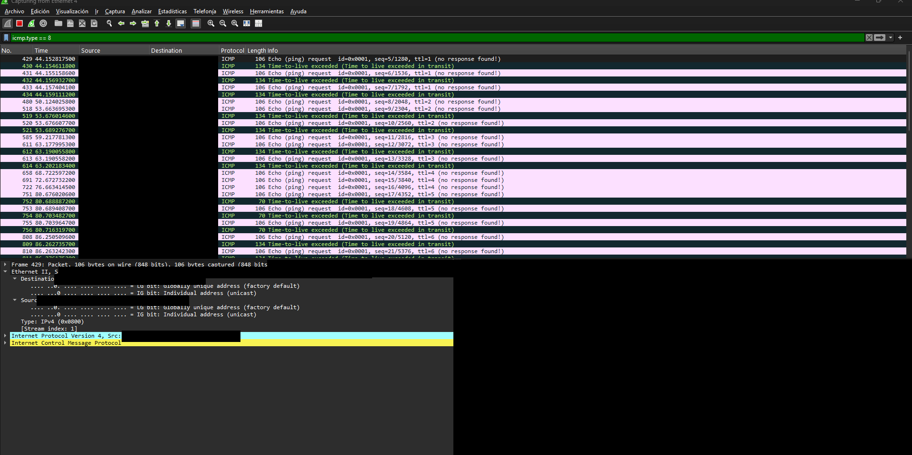

**`icmp`**: Al llegar con TTL 9 aparece el Echo Reply (TTL 115) y termina el recorrido.

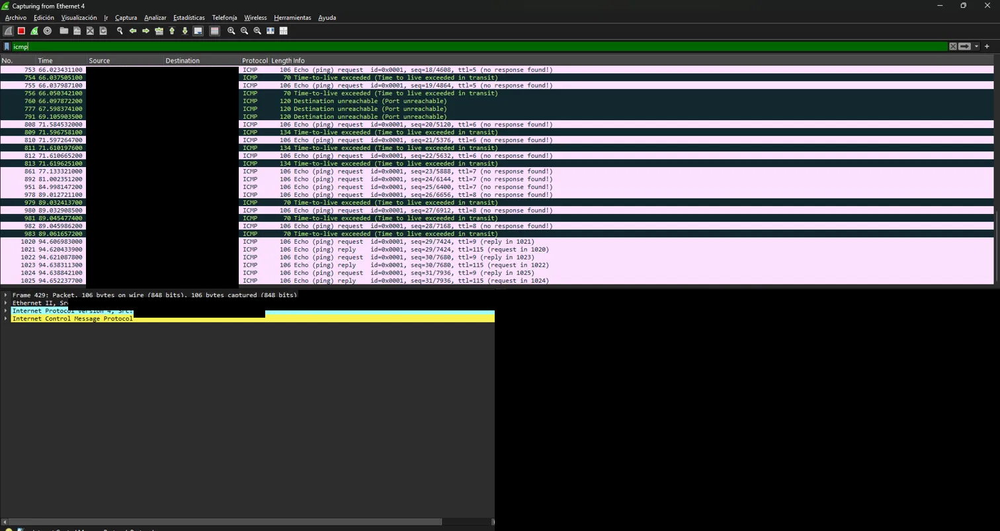

**`icmp.type == 11`**: Lista de mensajes tipo 11; el detalle muestra el paquete original encapsulado con `Time to Live: 1`.

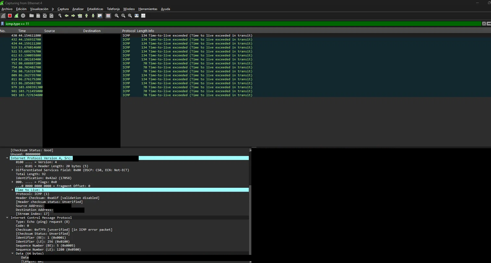

**`icmp.type == 11 && ip.src == <IP-gateway>`**: Tres respuestas del primer salto (los 3 intentos): el primer router es el gateway doméstico.

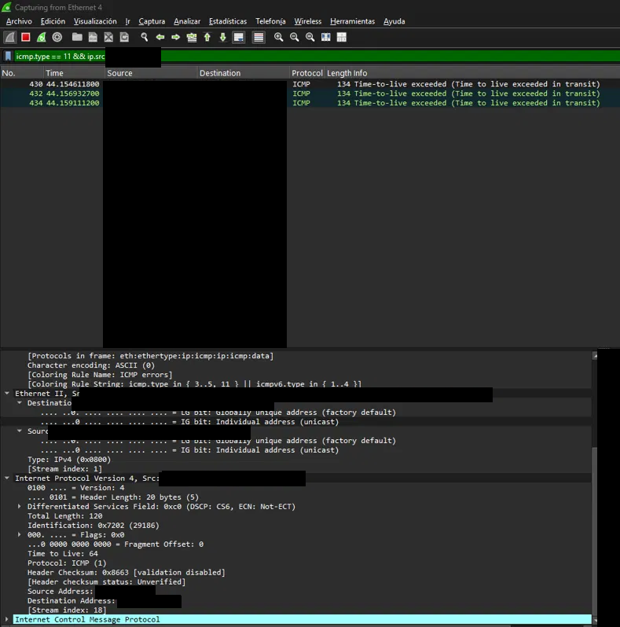


Respuestas del ejercicio:

1. **Saltos hasta el destino:** 9.
2. **TTL del request que recibió respuesta final:** 9.
3. **IP origen del primer tipo 11:** el gateway doméstico.

Detalles del `tracert`:

* **Dos saltos consecutivos con la misma IP:** probablemente un equipo del proveedor que apareció dos veces.
* **Saltos con `* * *`:** ese router descarta el paquete o no responde ICMP tipo 11. El paquete siguió su camino igual; solo ese salto quedó "mudo". Por eso `tracert` depende de que los routers quieran contestar.
* Algunos routers devuelven mensajes tipo 11 de 134 bytes y otros de 70: citan distinta cantidad del paquete original dentro del mensaje de error.

Pregunta sobre la MAC (filtro `icmp.type == 8`): la MAC destino del Echo Request es la del router, aunque la IP destino esté a 9 saltos. **La MAC solo sirve para llegar al próximo salto**, que es el gateway.

Preguntas finales:

1. **Campos IPv4 que cambian en cada salto:** el **TTL** (baja 1) y, como consecuencia, el **Header Checksum** (se recalcula). No cambian: versión, IP origen, IP destino ni protocolo. La MAC (capa 2) sí cambia en cada salto, pero no es un campo IPv4.
2. **¿Por qué la MAC destino es la del router si el destino es `8.8.8.8`?** Porque está fuera de la subred. La PC no puede hacer ARP de esa IP, así que arma la trama hacia la MAC de su gateway y el router se encarga de reenviarla.

### 7.3 Campo que identifica el protocolo de capa 4

|Versión|Campo|Valor|Protocolo|Ejemplo observado|
|-|-|-|-|-|
|IPv4|`Protocol`|1|ICMP|Ping y mensajes *Time-to-live exceeded*|
|IPv4|`Protocol`|6|TCP|Conexión HTTPS (puerto destino 443)|
|IPv4|`Protocol`|17|UDP|Broadcast del router hacia la subred|
|IPv6|`Next Header`|6|TCP|Tráfico entrante de un servidor externo|
|IPv6|`Next Header`|58|ICMPv6|Echo Request de `tracert -6`|

Evidencia (capturas censuradas):

**`ip.proto == 6`**: `Protocol: TCP (6)`, TTL 128

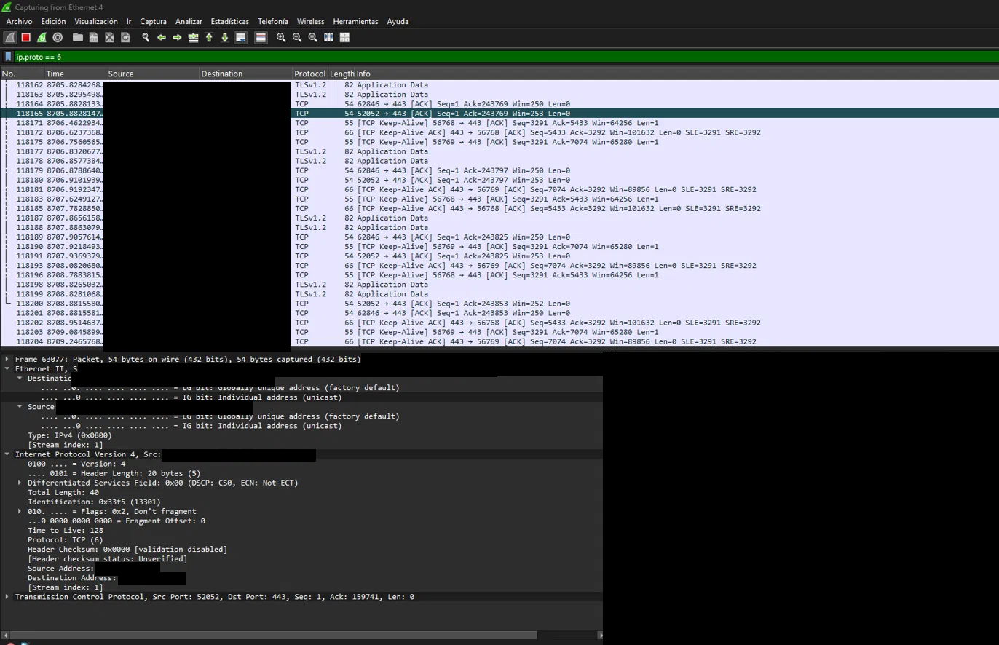

**`tcp`**: Mismo campo; el filtro `tcp` filtra por protocolo, no por el campo IP

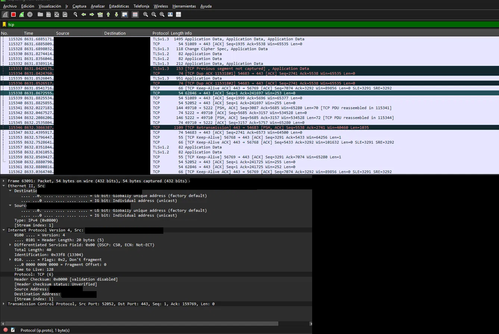

**`ipv6.nxt == 6`**: `Next Header: TCP (6)`, `Hop Limit`, `Payload Length: 20`

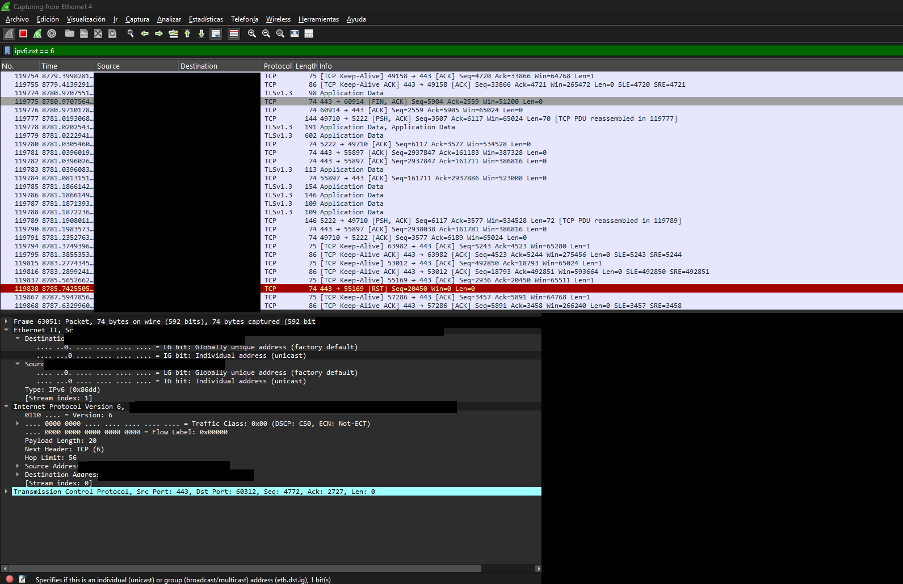


Observaciones:

* **TCP/IPv4:** TTL 128 (típico de Windows) y `Header Checksum: 0x0000` con validación deshabilitada (*offloading*). La MAC destino es la del router porque el destino está fuera de la subred.
* **UDP/IPv4:** el router envía un paquete a la **dirección de broadcast de la subred** (terminada en `.255`) y la MAC destino es `ff:ff:ff:ff:ff:ff`: broadcast en capa 3 y capa 2 a la vez. TTL 64, típico de un router.
* **TCP/IPv6:** `Payload Length: 20` equivale solo al encabezado TCP (segmento sin datos, `Len=0`). La MAC origen es la del router y la destino la de la PC, porque es tráfico entrante.

### 7.4 Broadcast y servicios que "hablan de más"

Con el filtro `udp` se observó, además del broadcast del router, tráfico típico de una LAN doméstica:

* **Consultas por broadcast** de resolución de nombres NetBIOS (NBNS), enviadas por equipos de la red.
* **Consultas DNS de `wpad`**, que la PC hace buscando una configuración automática de proxy; el servidor responde *No such name*.
* Las consultas DNS también viajan por **UDP sobre IPv6**.

Estos servicios son relevantes en seguridad (ver sección 10).

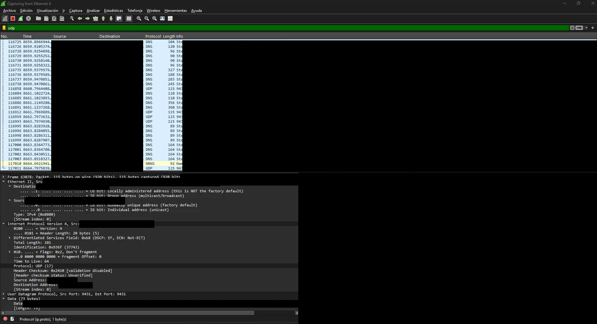

> En esta captura se ocultó también la columna *Info* porque las consultas DNS revelan los sitios visitados.

### 7.5 Ejercicio C: IPv6

Se usó el filtro `icmpv6` y `tracert -6` hacia un sitio externo:

* El destino se alcanzó en **8 saltos**, uno menos que por IPv4. El camino puede ser distinto según la versión del protocolo.
* En los **Echo Request** (`icmpv6.type == 128`): `Hop Limit` reemplaza al TTL y `Next Header: ICMPv6 (58)` reemplaza al `Protocol`. Otros campos: `Traffic Class: 0x00`, `Flow Label: 0x00000`, `Payload Length: 72`.
* Los **Time Exceeded** (`icmpv6.type == 3`) son el equivalente al tipo 11 de ICMPv4.
* El último salto fue la respuesta del servidor: Echo Reply con `Hop Limit` 113.
* **Diferencia importante:** IPv6 no usa ARP. La resolución de MAC se hace con **Neighbor Discovery** (`icmpv6.type == 135 || icmpv6.type == 136`, Neighbor Solicitation / Advertisement).

### 7.6 Relación con el laboratorio

|Packet Tracer|Wireshark (red real)|
|-|-|
|TTL 128 → 126 al cruzar 2 routers|TTL 128 al salir de la PC; el router responde con TTL 64|
|MAC destino = gateway para destinos remotos|Misma conducta con la MAC del router doméstico|
|IP origen/destino constantes|Confirmado en todas las capturas|
|Inspect PDU en capas 2 y 3|Panel de detalles de Wireshark|

## 8. Comparación IPv4 vs IPv6

|IPv4|IPv6|Lo que se vio|
|-|-|-|
|TTL|Hop Limit|Baja 1 por cada router|
|Protocol|Next Header|`0x3a` = 58 = ICMPv6|
|DSCP|Traffic Class|Equivalentes|
|Header Checksum|No existe|No hay checksum en el encabezado base de IPv6|
|IHL, Identification, Flags, Fragment Offset|No aparecen en el encabezado base|La fragmentación se maneja de otra forma|
|Total Length|Payload Length|En Packet Tracer apareció `PL = 108`|
|Direcciones de 32 bits|Direcciones de 128 bits|Ocupan 4 veces más espacio cada una|
|—|Flow Label|Campo nuevo|
|ARP|Neighbor Discovery (ICMPv6 135/136)|Cambia el mecanismo de resolución de MAC|

En la captura de Packet Tracer con IPv6 (Inspect PDU en PC1), la explicación del simulador es que el destino no está en la misma subred, así que **usa el gateway por defecto como siguiente salto**. La MAC destino `00E0.8F3B.B501` es la de Rock1 Gi0/0 (MAC ficticia del simulador). Es la decisión de reenvío del host, ahora en IPv6.

## 9. Qué cambia en cada salto (Conclusiones)

|Dato|¿Cambia entre saltos?|
|-|-|
|IP origen / destino|**No**|
|MAC origen / destino|**Sí**, en cada salto|
|TTL / Hop Limit|**Sí**, baja 1 en cada router|
|Header Checksum (IPv4)|**Sí**, se recalcula al cambiar el TTL|
|Protocol / Next Header|No|

* **Direcciones IP:** no cambian a lo largo del viaje del paquete.
* **Direcciones MAC:** cambian en cada salto de Capa 2 para entregar la trama al siguiente nodo conectado directamente. En el tramo entre routers (Rock1 → Rock2) cambian tanto la MAC origen como la destino, mientras las IP se mantienen.
* **TTL / Hop Limit:** decrementa en 1 por cada router (dispositivo de Capa 3) que reenvía el paquete.
* **Ruta predeterminada:** simplifica la tabla de enrutamiento en routers de borde, derivando todo el tráfico desconocido hacia el siguiente salto.
* **Gateway del host:** sin gateway, un host solo se comunica dentro de su subred.
* **Protocolo de capa 4:** se identifica con `Protocol` (IPv4) o `Next Header` (IPv6): 1 = ICMP, 6 = TCP, 17 = UDP, 58 = ICMPv6.

## 10. Relación con Seguridad

* Una ruta predeterminada mal configurada puede generar bucles de enrutamiento o desviar tráfico interno sensible hacia interfaces o redes no deseadas.
* Auditar las tablas de rutas (`show ip route`) constituye una de las primeras acciones defensivas ante incidentes de redirección de tráfico anómalo.
* **Fingerprinting por TTL:** un TTL cercano a 128 suele indicar Windows, y cercano a 64 Linux/equipos de red. Es una pista útil en reconocimiento, aunque no es concluyente porque el valor es modificable.
* **Reconocimiento con traceroute:** los mensajes ICMP tipo 11 revelan la topología y los saltos del proveedor. Filtrar o limitar ICMP en el borde reduce esa exposición.
* **Broadcast en capa 2/3:** el tráfico a `ff:ff:ff:ff:ff:ff` llega a todos los hosts de la LAN. Es la base de ataques de reconocimiento y de ARP spoofing.
* **NBNS, LLMNR y WPAD:** las consultas de nombres por broadcast y las búsquedas de `wpad` son un vector clásico de envenenamiento de nombres, porque un atacante en la LAN puede contestar antes que nadie. Mitigaciones habituales: deshabilitar NetBIOS sobre TCP/IP y LLMNR cuando no se necesitan, y definir `wpad` en el DNS interno.
* **IPv6 y Neighbor Discovery:** sin ARP, el equivalente de spoofing pasa por mensajes NS/NA falsos; por eso conviene conocer los tipos 135/136.
* **Capturas = datos sensibles:** una captura de red real contiene DNS, IPs y metadatos personales. Por eso este repositorio no publica archivos `.pcap` ni capturas completas.

## 11. Evidencias y privacidad

* Se publican capturas de **Packet Tracer** (direcciones ficticias).
* De Wireshark se publican capturas **censuradas** (rectángulos negros sólidos sobre IPs, MACs, fabricantes, GUID de la interfaz y panel hexadecimal), exportadas como PNG aplanado.
* No se publican: archivos `.pcap`, `ipconfig /all`, salidas completas de `tracert` ni capturas sin censurar.
* Antes de subir una captura nueva: revisar columnas *Source*/*Destination*, columna *Info* (DNS, HTTP), barra de filtros, línea `Frame … on interface`, línea `Ethernet II` y el panel de bytes.

## 12. Estructura del repositorio

```
lab-01-rutas-estaticas-y-predeterminada/
├── README.md
├── topologia/
│   └── topologia.png
├── capturas/
│   ├── 01-rock1-show-ip-route.png
│   ├── 02-pc1-ping-pc2-arp.png
│   ├── 03-pc1-ipconfig-arp.png
│   ├── 04-pc1-ping-pc3.png
│   ├── 05-rock2-show-ip-int-brief.png
│   ├── 06-pc1-sin-gateway-config.png
│   ├── 07-pc1-sin-gateway-ping.png
│   └── wireshark/            # capturas censuradas
├── configs/
│   ├── Rock1.txt
│   └── Rock2.txt
└── lab-01.pkt                # pendiente
```

## 13. Pendientes

* Agregar el archivo del laboratorio `.pkt` sanitizado.
* Verificar la configuración de Rock2 (`configs/Rock2.txt`, rutas de retorno) contra `show running-config` y quitar el aviso del encabezado.
* Repetir el análisis con tráfico del laboratorio (GNS3 o modo Simulación de Packet Tracer) usando filtros `icmp`, `arp` e `icmpv6`.
* Probar `ipv6.nxt == 17` y `ip.proto == 17` con el filtro bien aplicado (Enter) para confirmar UDP en ambas versiones.
